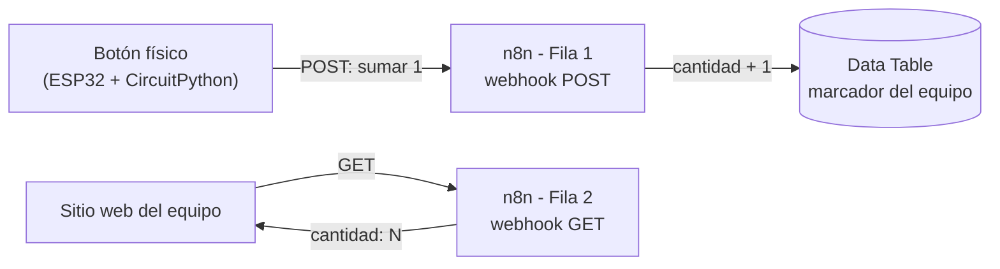
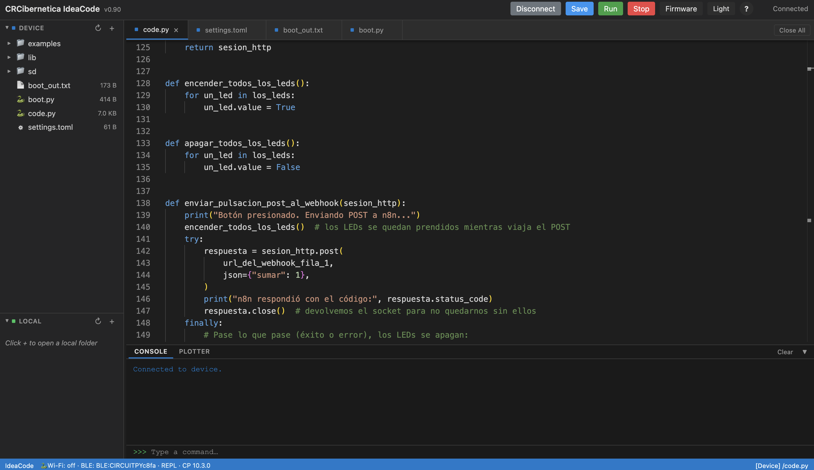
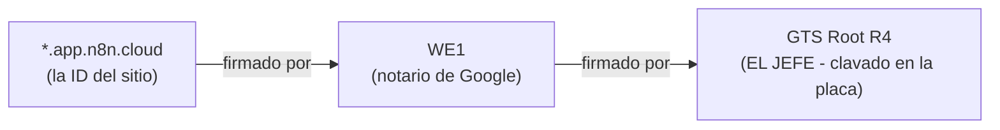

# Botón de Emociones — ESP32 → n8n → Sitio web

Sistema completo de clase: un **botón físico** (ESP32 con CircuitPython) que, al presionarlo, envía un POST por HTTPS a un webhook de **n8n**, que suma 1 en una Data Table. El **sitio web** del equipo pregunta el marcador con GET y lo muestra.

Diseñado para trabajar en equipos de 4-5 estudiantes, con material de clase en español y cero configuración oculta: todo lo que la placa necesita viaja dentro de los archivos de este repositorio.

## El mapa completo



1. Alguien presiona el botón. La placa enciende sus LEDs y hace `POST` con `{"sumar": 1}` a la Fila 1.
2. n8n lee el marcador en la Data Table y le suma 1.
3. El sitio web pregunta con `GET` a la Fila 2 y recibe `{"cantidad": N}`.
4. La Data Table es la memoria del sistema: n8n olvida todo entre ejecuciones y el sitio web no recibe avisos, tiene que preguntar.

## Qué hay en este repositorio

```text
├── README.md                <- este documento
├── code.py                  <- el programa de la placa (pegar y cambiar 1 línea)
├── settings.toml.example    <- plantilla del WiFi (el archivo real NO se sube)
├── assets/                  <- imágenes de la guía (capturas del editor)
└── .gitignore               <- evita subir credenciales y librerías por error
```

## Qué necesitas

**Hardware**

- Una placa **CRCibernetica IdeaBoard** (la de la clase de robótica, con módulo ESP32-WROOM-32E; es la placa para la que está diseñado este sistema)
- Un botón conectado a **IO27** (la placa usa resistencia pull-up interna: no necesita resistencia externa)
- Tres LEDs en **IO18, IO23 e IO25** (opcional: si no hay LEDs, el sistema funciona igual)

**Software**

- Una cuenta de n8n (cloud o self-hosted) con el workflow descrito abajo
- Nada más que un navegador (Chrome o Edge) y el cable USB. La IdeaBoard ya trae su firmware y sus librerías instalados de fábrica: todo se hace desde el editor web IdeaCode, en https://ideacode.crcibernetica.com/

## Puesta en marcha (5 minutos, todo en el navegador)



La IdeaBoard no necesita instalar nada: el firmware y las librerías ya vienen de fábrica. Todo se hace desde el editor web:

1. Entra a https://ideacode.crcibernetica.com/ con Chrome o Edge, conecta la placa por USB y presiona **Connect**.
2. Abre `settings.toml` en el árbol de archivos (a la izquierda) y escribe tu red (usa `settings.toml.example` de este repositorio como referencia):

```toml
WIFI_SSID = "NOMBRE_DE_TU_RED"
WIFI_PASSWORD = "CONTRASENA_DE_TU_RED"
```

El `settings.toml` real **nunca se sube a GitHub** (el `.gitignore` de este repo ya lo excluye). Es la regla número uno: las credenciales no viven en repositorios.

3. Abre `code.py`, pega el código de este repositorio y cambia la línea del webhook:

```python
url_del_webhook_fila_1 = "https://TU-CUENTA.app.n8n.cloud/webhook/TU-PATH-DE-FILA-1"
```

4. **Save** (Ctrl+S) y **Run** (Ctrl+R). La consola de abajo debe mostrar:

```text
Certificado raíz R4: 765 caracteres, checksum 62586
Listo. Presiona el botón para sumar.
```

Presiona el botón y debe aparecer:

```text
Botón presionado. Enviando POST a n8n...
n8n respondió con el código: 200
```

Y el marcador en la Data Table sube en 1. Si el sitio web se refresca, muestra el número nuevo.

## El lado de n8n (lo que debe existir antes)

El workflow tiene dos filas independientes. Cada equipo usa sus propios paths y su propia tabla, con su número en todos los nombres (`marcador-team-3`, etc.) para no chocar en un n8n compartido.

**Fila 1 (la que escucha al botón)**

Webhook (método POST, path propio) → Leer marcador (Data Table: Get) → Sumar (Data Table: Update, `cantidad + 1`). Responde "OK" directo: no necesita nodo de respuesta.

**Fila 2 (la que responde al sitio web)**

Webhook (método GET, path propio) → Leer marcador → Respond to Webhook con `{"cantidad": N}`.

**Data Table**

Una tabla por equipo, con columnas `equipo` (string) y `cantidad` (number).

## ¿Por qué hay un certificado adentro de `code.py`?

Porque el webhook es `https`, y HTTPS hace dos cosas: verifica **identidad** (que quien responde sea de verdad tu n8n y no un impostor en la red) y **cifra** la conversación (nadie en el camino puede leer ni alterar lo que viaja).

Para verificar identidad, la placa necesita confiar en alguien. Los navegadores traen una lista gigante de "jefes de notarios" preinstalada; este firmware trae la lista **vacía**, así que toda conexión https falla con un error críptico. La solución es *certificate pinning*: le entregamos **una única raíz de confianza**, embebida en el código.



La raíz es **GTS Root R4**, de Google Trust Services: válida hasta 2036 y pública (se publica en https://pki.goog/repository/). La placa exige que la ID que le muestra el servidor tenga firmas válidas hasta ese jefe. Impostores quedan fuera antes de que viaje un solo dato.

**El detector de fotocopias torcidas.** Copiar y pegar certificados puede corromperlos de forma invisible (historia real: dos letras traspuestas convirtieron una fecha de vencimiento en el "mes 20 del año 2029" y el error tardó dos horas en encontrar). Por eso `code.py` verifica su propio certificado al arrancar e imprime:

```text
Certificado raíz R4: 765 caracteres, checksum 62586
```

Si ves otros números, el bloque del certificado se corrompió al copiarlo: vuelve a copiarlo completo, del `-----BEGIN CERTIFICATE-----` al `-----END CERTIFICATE-----`.

**La fecha rara del año 2056.** No es error: es un bug real compensado. En esta placa hay dos relojes que no se hablan: el de CircuitPython cuenta segundos desde el año 2000 y el del TLS (mbedTLS) los lee como si contaran desde 1970. Sin corrección, el TLS viviría 30 años en el pasado. La línea que declara "el año real + 30" lo compensa. No la borres.

## Errores comunes y su solución

| Consola dice | Qué significa | Solución |
|---|---|---|
| `(-12288, MBEDTLS_ERR_X509_FATAL_ERROR)` | La placa no tiene a quién creerle | Verifica que `code.py` incluya el bloque `certificado_raiz_r4` completo |
| `(-9216, MBEDTLS_ERR_X509_INVALID_DATE)` | El certificado se corrompió al copiar | Verifica el checksum (765 y 62586) y vuelve a copiar el bloque |
| `Falló el POST. Revisa el WiFi o la URL` | Red o webhook equivocado | Revisa `settings.toml` y la línea `url_del_webhook_fila_1` |
| El año 2056 en la consola | Es la compensación del bug de relojes | Intencional. No tocar |
| Los LEDs no encienden | Pines distintos en tu placa | Ajusta `pines_de_los_leds` en la sección de configuración |

## Adaptar a otro hardware

Toda la configuración está en las primeras líneas de `code.py`: pines del botón (`pin_donde_esta_el_boton`) y de los LEDs (`pines_de_los_leds`). Con pull-up, `False` en el pin significa "presionado"; si tu botón está cableado al revés, ajusta `el_boton_esta_presionado()`. El sistema está pensado para la IdeaBoard; otras placas ESP32 podrían adaptarlo, pero ese camino no está documentado aquí.

## Notas de seguridad para el aula

- `settings.toml` jamás al repositorio (ya lo excluye el `.gitignore`).
- El URL del webhook es **semi-secreto**: quien lo adivine puede enviar pulsaciones falsas. En el curso esto es una feature: el "rol Hacker" del equipo intenta adivinar el webhook del otro equipo y luego se debate cómo protegerlo (paths aleatorios, Header Auth). HTTPS protege el *camino* (cifrado e identidad); la *puerta* (quién puede llamar al webhook) se protege aparte, con Header Auth.
- Siguiente nivel natural: que n8n exija una contraseña en el header y que `code.py` la envíe. Con eso, adivinar el URL deja de bastar.

## Contexto del proyecto

Creado por Camilo J. para un curso de tecnología y emociones en un colegio de Costa Rica: estudiantes de 13-15 años construyen el sitio web con IA, el workflow en n8n y el botón en la clase de robótica, y este repositorio es la pieza que une el mundo físico con la nube. El botón real que inspiró el sistema se construyó en clase, con una CRCibernetica IdeaBoard.

**Colaboradores:** Camilo, Valery y Fabricio.

Sugerencia de licencia: MIT, para que otros colegios puedan usarlo sin trámites.